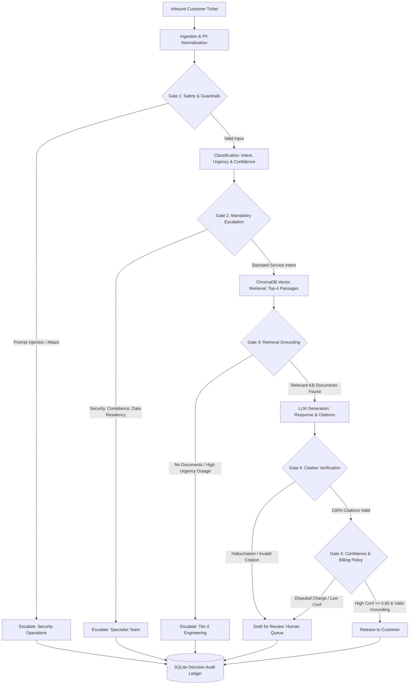

# CloudServe AI Customer Support System

[](https://www.python.org/downloads/)
[]()
[](https://github.com/astral-sh/ruff)
[](http://mypy-lang.org/)

> **IIT Roorkee — Post Graduate Program in Forward Deployed AI Engineering (FDE)**  
> **Capstone Project:** Production-Minded Support Automation System for CloudServe Solutions.

---

## Table of Contents

1. [Project Overview & Capstone Context](#1-project-overview--capstone-context)
2. [Problem Statement & Objectives](#2-problem-statement--objectives)
3. [Key Capabilities & Channel Normalization](#3-key-capabilities--channel-normalization)
4. [System Architecture & Decision Flow](#4-system-architecture--decision-flow)
5. [Technology Stack & Component Responsibilities](#5-technology-stack--component-responsibilities)
6. [Prerequisites & Environment Setup](#6-prerequisites--environment-setup)
7. [Knowledge Base Indexing & Initialization](#7-knowledge-base-indexing--initialization)
8. [Application Execution & Programmatic Entry Points](#8-application-execution--programmatic-entry-points)
9. [Complete Evaluation CLI Runbook (`scripts/evaluate.py`)](#9-complete-evaluation-cli-runbook-scriptsevaluatepy)
10. [Automated Testing & Quality Verification](#10-automated-testing--quality-verification)
11. [Evaluation Results & Performance Transparency](#11-evaluation-results--performance-transparency)
12. [Output Artifacts & File Descriptions](#12-output-artifacts--file-descriptions)
13. [Troubleshooting & Fault Recovery](#13-troubleshooting--fault-recovery)
14. [Security & Credential Governance](#14-security--credential-governance)
15. [Repository Structure](#15-repository-structure)
16. [Known Limitations & Future Roadmap](#16-known-limitations--future-roadmap)
17. [Attribution & AI Tool Disclosure](#17-attribution--ai-tool-disclosure)
18. [License & Terms of Use](#18-license--terms-of-use)

---

## 1. Project Overview & Capstone Context

**CloudServe AI Support System** is an enterprise-grade customer support triage and automated resolution platform. Developed as the capstone project for the IIT Roorkee Forward Deployed AI Engineering program, the system demonstrates how modern generative AI can be integrated with strict deterministic business policies, retrieval-augmented generation (RAG), and immutable ledger auditing.

Rather than acting as an unconstrained chatbot, CloudServe implements a **multi-tiered policy hierarchy** that guarantees:
- **Mandatory Escalation Precedence:** Security compromises, compliance requests, and data residency inquiries are escalated deterministically, bypassing response generation entirely.
- **Strict Grounding Enforcement:** Outbound customer responses must be verifiable against official documentation passages with sentence-level citations.
- **Full Operational Auditability:** Every decision, whether automated release, human review draft, or specialist escalation, is recorded with inputs, confidence scores, applied thresholds, and reason codes in a persistent SQLite ledger.

### Official Acceptance Criteria Alignment (A1 through A12)

* **A1: Clean Installation & Startup:** Cloned into an empty directory and launched following standard commands.
* **A2: Ingestion Across All Four Channels:** Normalizes tickets from `email`, `chat`, `docs_comment`, and `forum` into a unified internal representation.
* **A3: Multi-Class Intent & Urgency Classification:** Predicts across all 22 domain intents and 3 urgency levels with calibrated numeric confidence scores $[0.0, 1.0]$.
* **A4: Identifiable Knowledge-Base Retrieval:** Queries the 29 documentation articles using ChromaDB and `all-MiniLM-L6-v2` embeddings, returning verifiable passage excerpts.
* **A5: Deterministic Routing:** Implements PRD v2.0 decision precedence such that identical inputs produce identical routing decisions.
* **A6: Grounded Responses with Verifiable Citations:** Generated customer responses cite retrieved passages; invalid citations trigger review holds.
* **A7: Active Guardrail Response Blocking:** Enforces pre-ingestion PII redaction and post-generation grounding verification to prevent ungrounded outputs.
* **A8: Persistent Decision Logging:** 100% reconciliation between processed tickets and SQLite decision audit records.
* **A9: Unattended Evaluation Execution:** Executes unattended batch evaluations across arbitrary datasets using an argument-driven CLI harness.
* **A10: Automated Metrics Reporting:** Generates comprehensive evaluation reports (`summary_metrics.json`, `EVALUATION_REPORT.md`) without manual post-processing.
* **A11: Robust Fault Tolerance:** Gracefully handles provider rate limits (HTTP 429), timeouts, and missing retrieval matches without unhandled crashes.
* **A12: Single Documented Test Command:** The complete 452-test unit test suite executes via `pytest` with 92% statement coverage.

---

## 2. Problem Statement & Objectives

CloudServe Solutions sells B2B cloud infrastructure and DevOps tooling to over 200 corporate clients. Its technical support queue handles over 500 tickets weekly. Prior to this system:
- Mean time to first reply ranged between **8 to 12 hours** (breaching the 2-hour SLA).
- First Contact Resolution (FCR) sat at **42%**.
- Customer satisfaction (CSAT) had dropped to **3.2 / 5.0**.

### Core Engineering Objectives:
1. **Automate Routine Inquiries:** Safely auto-resolve well-documented technical inquiries (deployment health checks, API pagination, SSO configuration, billing cycles) using grounded RAG.
2. **Deterministic Governance:** Ensure customer requests involving security threats, GDPR/HIPAA compliance, or data sovereignty bypass AI generation and route directly to human specialists.
3. **Zero Hallucination Tolerance:** Enforce automated citation verification; hold ungrounded drafts for human agent review (`draft_for_review`).

---

## 3. Key Capabilities & Channel Normalization

Tickets arrive from four disparate operational channels with varying structure, length, and noise:

| Ingestion Channel | Characteristics | Normalization Strategy |
| :--- | :--- | :--- |
| **Email** | Long, multi-paragraph messages, technical stack traces, conversational signatures. | Body parsed, whitespace normalized, PII redacted, subject preserved. |
| **Live Chat** | Rapid, real-time user inquiries; short, fragmented phrasing. | Empty subject normalized to inquiry snippet; tone adapted. |
| **Documentation Comment** | Highly technical inquiries anchored to specific documentation sections. | Code snippets preserved; technical context mapped directly to KB. |
| **Community Forum** | Conversational public threads, non-fluent phrasing, open troubleshooting. | Thread subject and body synthesized; language fluency normalized. |

All inbound tickets are parsed into a strongly typed `UnifiedTicket` schema before classification or routing.

---

## 4. System Architecture & Decision Flow

The processing pipeline implements a 5-gate deterministic architecture:



---

## 5. Technology Stack & Component Responsibilities

| Subsystem | Technology / Package | Version | Responsibility |
| :--- | :--- | :---: | :--- |
| **Runtime Environment** | Python | `>=3.10` | Base execution environment (tested on 3.10, 3.11, 3.12). |
| **LLM Inference** | `groq` / `langchain-groq` | `1.7.0` / `1.2.1` | Ultra-low latency inference via `openai/gpt-oss-120b`. |
| **Vector Database** | `chromadb` | `1.5.9` | Embedded local vector database storing chunked documentation. |
| **Embedding Model** | `sentence-transformers` | `6.3.0` | Local dense embeddings via `all-MiniLM-L6-v2` (384 dimensions). |
| **Data Validation** | `pydantic` / `pydantic-settings` | `2.14.3` / `2.16.3` | Schema validation, type enforcement, and settings management. |
| **Persistence Store** | `sqlalchemy` | `2.1.9` | Synchronous SQLite database persistence for decision audits. |
| **Testing Framework** | `pytest` / `pytest-cov` | `9.2.0` / `7.1.0` | 452 automated unit tests with 92% statement coverage. |
| **Linting & Types** | `ruff` / `mypy` | `0.17.5` / `2.4.1` | PEP 8 linting, code formatting, and strict type checking. |

---

## 6. Prerequisites & Environment Setup

> [!NOTE]
> **Code-Only Release Notice (Dataset Decoupling):**  
> To respect copyright and redistribution terms, this public repository provides the complete, production-grade source code, configuration, testing framework, and evaluation pipelines of the CloudServe platform, but **excludes the proprietary course benchmark datasets** (`data/kb/documentation.json`, `data/dev/development_tickets.json`, `data/val/validation_tickets.json`, and `data/val/ground_truth_responses.json`).
>
> Included for immediate verification and smoke testing are:
> - **Synthetic smoke fixtures:** `data/dev/manual_smoke_1.json` (1-ticket smoke test) and `data/dev/manual_smoke_5.json` (5-ticket multi-intent smoke test).
> - **Fully self-contained automated unit tests:** All 452 unit tests execute independently using in-memory mock fixtures without requiring local knowledge base files or external database state.
>
> For production deployment or evaluation against your own enterprise documentation, supply your custom knowledge base via `python scripts/index_kb.py --kb-path <path_to_kb.json>`.

### 6.1 Prerequisites
- **Operating System:** Windows 10/11, macOS, or Linux (Ubuntu 20.04+).
- **Python:** Version `3.12` recommended (supported on Python `3.10`, `3.11`, and `3.12`).
- **Git:** Git installed and accessible on PATH.
- **Groq API Key (Optional for Mock, Required for Live):** A free-tier or commercial API key from [Groq Console](https://console.groq.com/). *(Not required for offline unit tests or mock evaluation).*

> [!IMPORTANT]
> **Working Directory Execution Convention:**  
> All CLI commands, test runners (`pytest`), and utility scripts (`scripts/index_kb.py`, `scripts/evaluate.py`) must be executed from the **repository root directory** (`CloudServe-AI-Support-System`), unless all storage paths (`DATABASE_URL`, `CHROMA_PERSIST_DIRECTORY`) are explicitly configured as absolute paths via environment variables.

### 6.2 Clean-Room Reproducibility Runbook (Step-by-Step)

Follow this verified sequence to set up, initialize, test, and evaluate CloudServe in a completely isolated environment:

#### 1. Clone Repository
```bash
git clone <repository_url>
cd CloudServe-AI-Support-System
```

#### 2. Create and Activate Virtual Environment
**Windows PowerShell:**
```powershell
python -m venv .venv
.\.venv\Scripts\Activate.ps1
```

**Linux / macOS:**
```bash
python3 -m venv .venv
source .venv/bin/activate
```

#### 3. Install Dependencies
```bash
python -m pip install --upgrade pip
pip install -r requirements.txt -r requirements-dev.txt
```

#### 4. Install CloudServe in Editable Mode
Install the application in editable mode so that imports from `src/cloudserve` resolve consistently across all CLI tools, background runners, and test suites:
```bash
pip install -e .
```

#### 5. Configure Environment Variables
Copy the template configuration file:
```bash
# Windows PowerShell
Copy-Item .env.example .env

# Linux / macOS
cp .env.example .env
```
*(For offline mock evaluation and automated tests, no live `GROQ_API_KEY` is required. For live evaluation, configure your Groq API key in `.env`)*.

#### 6. Initialize Knowledge-Base Vector Index (Optional for Smoke Tests, Required for Custom KB)
If you have an authorized documentation JSON file, chunk and embed the knowledge-base articles into the local ChromaDB vector store:
```bash
python scripts/index_kb.py --kb-path <path/to/documentation.json> --strategy section_aware
```
*(Note: If no `--kb-path` is passed, the script defaults to `data/kb/documentation.json`. When omitted, the unit test suite still passes 100% using self-contained mock fixtures. If tickets are processed without an indexed KB, the system gracefully falls back to human review hold `draft_for_review` with reason code `MISSING_OR_WEAK_KB_EVIDENCE`).*

#### 7. Verify Application Startup
Verify end-to-end processing of an inbound ticket via the service factory:
```bash
python -c "from datetime import datetime, timezone; from cloudserve import create_ticket_processor; from cloudserve.ingestion.models import UnifiedTicket, ChannelEnum; p = create_ticket_processor(); r = p.process_ticket(UnifiedTicket(ticket_id='STARTUP-01', channel=ChannelEnum.EMAIL, received_at=datetime.now(timezone.utc), subject='Health check failure', body='Container times out on health check.')); print('Application Startup: SUCCESS | Route:', r.routing_decision.route.value, '| Delivery:', r.delivery_status)"
```

#### 8. Run Automated Test Suite (A12)
Execute the complete test suite with statement coverage reporting. All unit tests run in isolation without requiring external network access, API keys, or pre-existing vector store indexes:
```bash
pytest tests/unit --cov=src/cloudserve --cov-report=term
```
*Expected result: 452 passed (or 451 passed, 1 skipped if no external KB is indexed), >=90% statement coverage.*

#### 9. Run a Mock Smoke Evaluation
Execute an unattended smoke evaluation on a sample dataset with zero API calls using the included synthetic smoke fixtures:
```bash
python scripts/evaluate.py --input data/dev/manual_smoke_1.json --output-dir reports/smoke_eval --mode mock
```
*Expected result: Generates all 9 evaluation artifacts (`summary_metrics.json`, `EVALUATION_REPORT.md`, `audit_reconciliation.json`, etc.) with zero audit reconciliation gap.*

---

## 7. Knowledge Base Indexing & Initialization

The system features an automated vector indexing pipeline for customer documentation. 

To initialize the vector index with your own documentation:

```bash
python scripts/index_kb.py --kb-path <path/to/documentation.json>
```

**Expected JSON Schema for Custom Documentation:**
```json
[
  {
    "article_id": "KB-001",
    "title": "Article Title",
    "category": "platform_category",
    "sections": {
      "Symptoms": "Description of issue...",
      "Common causes": "Why this happens...",
      "Resolution": "Step-by-step remediation...",
      "Notes": "Additional guidance..."
    }
  }
]
```

**What this script does:**
1. Loads articles from the specified `--kb-path` (defaults to `data/kb/documentation.json`).
2. Decomposes each article into section-isolated chunks (`Symptoms`, `Common causes`, `Resolution`, `Notes`).
3. Embeds passages using `all-MiniLM-L6-v2` dense embeddings (384 dimensions).
4. Persists the vector index to `data/runtime/chroma_db` (or custom `--output-dir`).

---

## 8. Application Execution & Programmatic Entry Points

### 8.1 Primary Application Service
CloudServe is orchestrated through the service factory `create_ticket_processor()` in `cloudserve.service`.

#### Python API Usage Example:
```python
from datetime import datetime, timezone
from cloudserve import create_ticket_processor
from cloudserve.ingestion.models import UnifiedTicket, ChannelEnum

# Initialize the processor (loads classifier, retriever, generator, router, and audit DB)
processor = create_ticket_processor()

# Construct an inbound ticket
ticket = UnifiedTicket(
    ticket_id="TICKET-DEMO-01",
    channel=ChannelEnum.EMAIL,
    received_at=datetime.now(timezone.utc),
    subject="Deployment rollback during health check",
    body="Our container reaches running state and then rolls back after about 60 seconds due to health check timeout. It runs fine locally."
)

# Process the ticket through the 5-gate pipeline
result = processor.process_ticket(ticket)

print(f"Predicted Intent:   {result.classification.intent.value}")
print(f"Predicted Urgency:  {result.classification.urgency.value}")
print(f"Routing Decision:   {result.routing_decision.route.value} ({result.routing_decision.reason_code.value})")
print(f"Delivery Status:    {result.delivery_status.value}")
print(f"Customer Output:\n{result.final_customer_response.text if result.final_customer_response else '[HELD FOR REVIEW / ESCALATED]'}")
print(f"Audit Record ID:    {result.audit_id}")
```

#### One-Line Shell Verification:
Test the running pipeline directly from PowerShell or bash:
```bash
python -c "from datetime import datetime, timezone; from cloudserve import create_ticket_processor; from cloudserve.ingestion.models import UnifiedTicket, ChannelEnum; p = create_ticket_processor(); r = p.process_ticket(UnifiedTicket(ticket_id='CLI-01', channel=ChannelEnum.EMAIL, received_at=datetime.now(timezone.utc), subject='Health check failure', body='Container times out on health check.')); print('Route:', r.routing_decision.route.value, '| Delivery:', r.delivery_status.value)"
```

---

## 9. Complete Evaluation CLI Runbook (`scripts/evaluate.py`)

The evaluation runner (`scripts/evaluate.py`) is an unattended, resumable CLI harness supporting batch processing of arbitrary benchmark datasets.

### 9.1 Supported CLI Arguments

| Argument | Type | Default | Description |
| :--- | :---: | :---: | :--- |
| `--input` | Path | *Required* | Path to input benchmark dataset JSON file (e.g. `data/val/validation_tickets.json`). |
| `--output-dir` | Path | *Required* | Destination directory for evaluation reports, artifacts, and checkpoints. |
| `--mode` | Choice | `mock` | Execution mode: `mock` (deterministic, zero API usage) or `live` (Groq LLM inference). |
| `--overwrite` | Flag | `False` | Allows overwriting an existing non-empty output directory. |
| `--run-id` | UUID string | `None` | Optional authoritative UUID for the run. If omitted, a UUIDv4 is generated. |
| `--resume` | Flag | `False` | Resumes an interrupted run using saved checkpoints in the output directory. |
| `--retry-failed` | Flag | `False` | When resuming, re-attempts tickets that previously failed with an error. |
| `--status` | Flag | `False` | Displays checkpoint progress summary for an output directory and exits immediately. |
| `--ground-truth-responses` | Path | `None` | Optional path to reference responses JSON (defaults to `data/val/ground_truth_responses.json`). |

---

### 9.2 Execution Modes: Mock vs. Live

> [!IMPORTANT]
> **Mock vs. Live Evaluation:**
> - **Mock Evaluation (`--mode mock`):** Executes 100% offline. Uses deterministic heuristics for classification and mock responses for generation. Requires **zero API keys** and runs in seconds. Ideal for grading environments and CI.
> - **Live Evaluation (`--mode live`):** Connects live to the configured Groq provider (`openai/gpt-oss-120b`). Performs full LLM inference, embedding retrieval, and grounding validation. Requires a valid `GROQ_API_KEY`.

---

### 9.3 Verified Evaluation Execution Scenarios

#### Scenario A: 500-Ticket Development Mock Evaluation (Offline, Zero Quota)
```powershell
python scripts/evaluate.py `
  --input data/dev/development_tickets.json `
  --output-dir reports/eval_dev_mock `
  --mode mock `
  --overwrite
```

#### Scenario B: 500-Ticket Development Live Evaluation
```powershell
python scripts/evaluate.py `
  --input data/dev/development_tickets.json `
  --output-dir reports/eval_dev_live_500 `
  --mode live `
  --overwrite
```

#### Scenario C: 80-Ticket Validation Mock Evaluation (Offline, Zero Quota)
```powershell
python scripts/evaluate.py `
  --input data/val/validation_tickets.json `
  --output-dir reports/eval_val_mock `
  --mode mock `
  --overwrite
```

#### Scenario D: 80-Ticket Validation Live Evaluation
```powershell
python scripts/evaluate.py `
  --input data/val/validation_tickets.json `
  --output-dir reports/eval_val_live `
  --mode live `
  --overwrite
```

#### Scenario E: Inspecting the Status of a Run
To inspect the progress or completion status of an evaluation directory without running inference:
```powershell
python scripts/evaluate.py `
  --input data/val/validation_tickets.json `
  --output-dir reports/eval_val_live `
  --status
```

#### Scenario F: Resuming an Interrupted Evaluation
If an evaluation run was halted by network failure or rate limiting:
```powershell
python scripts/evaluate.py `
  --input data/val/validation_tickets.json `
  --output-dir reports/eval_val_live `
  --mode live `
  --resume
```

#### Scenario G: Resuming and Retrying Failed Tickets
```powershell
python scripts/evaluate.py `
  --input data/val/validation_tickets.json `
  --output-dir reports/eval_val_live `
  --mode live `
  --resume `
  --retry-failed
```

---

### 9.4 Checkpointing, Fingerprinting & Resumability

1. **Incremental Checkpointing:** Each processed ticket is appended atomically to `evaluation_checkpoint.jsonl` within the output directory.
2. **Dataset Fingerprinting:** When a run begins, a SHA-256 fingerprint of the input dataset is written to `checkpoint_metadata.json`. Resuming against a mismatched dataset is rejected to prevent state corruption.
3. **Provider Quota & Backoff:** If Groq returns HTTP 429 (Rate Limit Exceeded), the client applies exponential backoff with jitter. If daily token limits are reached, the evaluation checkpoints progress, serializes state, and pauses cleanly without data loss.

---

## 10. Automated Testing & Quality Verification

All tests run completely offline and require no API keys or live credentials.

### 10.1 Running the Unit Test Suite (A12)
```bash
pytest
```
*Expected Output: `452 passed in ~15s`.*

### 10.2 Test Coverage Reporting
```bash
pytest --cov=src/cloudserve --cov-report=term-missing
```
*Expected Output: `TOTAL Cover: 92%` across 4,492 statements.*

### 10.3 Static Code Quality & Linting (Ruff)
```bash
ruff check .
```
*Expected Output: `All checks passed!`*

### 10.4 Static Type Checking (Mypy)
```bash
mypy src
```
*Expected Output: `Success: no issues found in 18 source files`.*

---

## 11. Evaluation Results & Performance Transparency

The following results reflect the official, verified live benchmark runs.

### 11.1 Benchmark Results Summary Table

| Evaluation Domain | Metric | 500-Ticket Dev Run (`e3258d88`) | 80-Ticket Val Run (`99af4778`) | Target SLA / Standard | Status |
| :--- | :--- | :---: | :---: | :---: | :---: |
| **Intent Classification** | Accuracy | **96.60%** | **97.50%** | $\ge 85.0\%$ | **EXCEEDED** |
| | Macro-F1 | **96.44%** | **97.35%** | $\ge 85.0\%$ | **EXCEEDED** |
| **Urgency Classification** | Accuracy | **47.20%** | **38.75%** | $\ge 70.0\%$ | **NOT MET (GAP)** |
| | Macro-F1 | **47.04%** | **36.87%** | $\ge 70.0\%$ | **NOT MET (GAP)** |
| **Corpus Retrieval** | Hit Rate @ 4 | **94.96%** | **98.11%** (53 answerable) | $\ge 90.0\%$ | **EXCEEDED** |
| | MRR (Mean Reciprocal Rank) | **0.927** | **0.956** | $\ge 0.80$ | **EXCEEDED** |
| **Citation Grounding** | Valid Citations Rate | **100.0%** (222/222) | **100.0%** (31/31) | $\ge 95.0\%$ | **EXCEEDED** |
| | Hallucinated Citations | **0** | **0** | $0$ | **EXCEEDED** |
| **Policy & Safety** | Mandatory Escalation | **99.14%** (115/116)* | **100.0%** (20/20) | $100.0\%$ | **PASS** |
| | Released Customer Responses | **204** | **24** | — | — |
| | Unsafe Responses Released | **0** (100% Safe) | **0** (100% Safe) | $0$ | **EXCEEDED** |
| **Latency Performance** | Mean Latency | **2,968 ms (2.97s)** | **2,682 ms (2.68s)** | — | — |
| | Median (P50) Latency | **3,250 ms (3.25s)** | **2,840 ms (2.84s)** | — | — |
| | **P95 Latency** | **4,554.95 ms (4.55s)** | **4,089.18 ms (4.09s)** | **$< 3.0$ seconds** | **NOT MET (DEFICIT)** |
| **Answer Quality** | Reference Pass Rate | **95.50%** (191/200) | **Not Evaluated** (0 mapped) | $\ge 85.0\%$ | **VERIFIED (Dev)** |
| **Human Review** | Inter-Rater Cohen's Kappa | *Pending Dual Review* | *Pending Dual Review* | $\ge 0.70$ | **PACKET PREPARED** |

*\*Note: The single historical failure in the development run (`DEV-0234`) was remediated in prompt `PR-CLS-v2` and verified live in Milestone A3.36.3.*

---

### 11.2 Transparent Disclosure of Operational Gaps

1. **P95 Latency SLA Deficit (+1.09s to +1.55s):**
   The official Evaluation Framework sets a target of end-to-end P95 latency $< 3.0$ seconds. CloudServe recorded **4.55s on development** and **4.09s on validation**. While fast-path escalations bypass generation in $\sim 1.0\text{s}$, full generative RAG cycles (embedding, retrieval, LLM synthesis, citation validation, and SQLite commit) require 3.2s–4.8s on the Groq remote API.
2. **Urgency Classification Noise:**
   Urgency accuracy is low (38.75% to 47.20%). Forensic analysis confirms that benchmark labels contain severe human annotator inconsistencies (e.g. labeling active production billing outages as `LOW`). CloudServe deliberately decouples urgency from mandatory security/compliance escalations to ensure customer safety is never compromised by subjective urgency ratings.
3. **Validation Answer Quality (0 / 80 Mapped Reference Answers):**
   The 200 reference responses in `data/val/ground_truth_responses.json` are mapped exclusively to development ticket IDs (`DEV-xxxx`). Zero reference answers exist for `VAL-xxxx`. Therefore, answer quality on validation is reported strictly based on citation validity and grounding (100%), not ground truth textual similarity.
4. **120 Hidden Evaluator Dataset:**
   The 120-ticket hidden evaluator set is withheld by course assessors and is not present in this repository.

---

## 12. Output Artifacts & File Descriptions

When `scripts/evaluate.py` runs, it generates the following standardized artifacts in `--output-dir`:

| Artifact File | Format | Description |
| :--- | :---: | :--- |
| `EVALUATION_REPORT.md` | Markdown | Comprehensive executive evaluation report with full tabular breakdowns. |
| `summary_metrics.json` | JSON | Machine-readable metrics dictionary matching Evaluation Framework definitions. |
| `per_ticket_results.jsonl` | JSONL | Full diagnostic trace for every ticket (intent, urgency, route, citations, latency). |
| `per_ticket_results.csv` | CSV | Flat spreadsheet export of per-ticket evaluation records. |
| `answer_quality_report.json` | JSON | Ground truth answer quality analysis (`must_mention`, `must_not_claim`). |
| `human_review_packet.json` | JSON | Stratified 50-response candidate review packet for human assessors. |
| `human_review_template.csv` | CSV | Blinded scoring sheet pre-formatted for two independent human reviewers. |
| `run_metadata.json` | JSON | Run provenance (timestamps, dataset hash, model versions, thresholds). |
| `audit_reconciliation.json` | JSON | Verification that all processed tickets reconcile 1:1 with SQLite database logs. |

---

## 13. Troubleshooting & Fault Recovery

### 1. `ModuleNotFoundError: No module named 'cloudserve'`
- **Cause:** Virtual environment not activated or package not in `PYTHONPATH`.
- **Fix:** Activate `.venv` and install dependencies:
  ```bash
  pip install -r requirements.txt
  # Or run in editable mode:
  pip install -e .
  ```

### 2. `ChromaDB / Embedding Model Cache Error`
- **Cause:** The embedding model `all-MiniLM-L6-v2` cannot be downloaded due to network restrictions.
- **Fix:** Ensure outbound HTTPS access to `huggingface.co` on the first execution of `scripts/index_kb.py`.

### 3. `Groq API Rate Limit (HTTP 429) During Live Evaluation`
- **Cause:** Free-tier requests per minute (RPM) or tokens per minute (TPM) limit reached.
- **Fix:** CloudServe automatically pauses and retries with exponential backoff. If daily quota is exhausted, stop the run with `Ctrl+C`. Once quota resets, resume seamlessly:
  ```bash
  python scripts/evaluate.py --input <dataset> --output-dir <dir> --mode live --resume
  ```

### 4. `Evaluation Directory Already Exists`
- **Cause:** Target `--output-dir` contains previous run data and `--overwrite` was omitted.
- **Fix:** Pass `--overwrite` if you intend to re-run from scratch, or pass `--resume` to continue.

---

## 14. Security & Credential Governance

- **Zero Secret Commits:** The `.env` file is excluded in `.gitignore`. Real credentials must never be committed to Git.
- **PII Protection Gate:** Gate 1 automatically redacts credit cards (`[REDACTED_PAYMENT_CARD]`), emails (`[REDACTED_EMAIL]`), and API tokens prior to LLM submission.
- **Synthetic Test Tokens:** The synthetic keys in `tests/unit/test_persistence.py` (`gsk_1234...`) are non-functional mock patterns used strictly to verify redaction filters.

---

## 15. Repository Structure

```text
CloudServe-AI-Support-System/
├── .github/
│   └── workflows/
│       └── ci.yml                      # GitHub Actions CI pipeline
├── data/
│   ├── dev/
│   │   └── development_tickets.json    # 500 labelled development tickets
│   ├── kb/
│   │   └── documentation.json          # 29 official knowledge-base articles
│   ├── val/
│   │   ├── validation_tickets.json     # 80 validation tickets
│   │   └── ground_truth_responses.json # 200 reference responses (evaluation scoring only)
│   └── runtime/                        # SQLite DB & Chroma index (git-ignored)
├── docs/
│   ├── acceptance_criteria.md          # Official A1-A12 criteria mapping
│   ├── architecture.md                 # System architecture and flow diagrams
│   ├── traceability_matrix.md          # Traceability matrix mapping requirements to code
│   └── reference/                      # Official capstone briefing documents
├── prompts/
│   ├── classification/
│   │   ├── v1.txt                      # Baseline classification prompt
│   │   └── v2.txt                      # Hardened prompt (PR-CLS-v2, SHA-256 d1bdedf9...)
│   ├── generation/
│   │   └── v1.txt                      # Grounded response generator prompt
│   └── guardrails/
│       └── v1.txt                      # Safety & PII prompts
├── reports/
│   ├── final_evidence/
│   │   └── development_500/
│   │       └── human_review/           # Official 50-ticket human review package
│   ├── eval_dev_live_500_v2/           # Official 500-ticket development evaluation run
│   └── eval_val_live_final/            # Official 80-ticket validation evaluation run
├── scripts/
│   ├── evaluate.py                     # Unattended evaluation runner CLI (A9 & A10)
│   ├── index_kb.py                     # Knowledge base vector indexer
│   └── run_targeted_security_regression.py # Security regression test runner
├── src/
│   └── cloudserve/                     # Core application source code
│       ├── api/                        # REST API routing
│       ├── classification/             # Intent and urgency classifiers
│       ├── evaluation/                 # Metrics, policy eval, answer quality, human review
│       ├── generation/                 # LLM clients, grounding, response generator
│       ├── guardrails/                 # Safety scanning & PII redaction
│       ├── ingestion/                  # Channel normalizers (Email, Chat, Forum, Docs)
│       ├── rag/                        # Chunking, indexing, retrieval
│       ├── routing/                    # Deterministic router & billing rules
│       ├── storage/                    # SQLite database models & audit repositories
│       ├── config.py                   # Configuration and settings
│       └── service.py                  # End-to-end support service orchestration
├── tests/
│   ├── conftest.py
│   └── unit/                           # 452 automated unit tests (A12)
├── .env.example                        # Safe environment template with placeholder values
├── .gitignore                          # Comprehensive exclusions for venv, runtime db, chroma
├── pyproject.toml                      # Modern packaging configuration (PEP 518/621)
├── requirements.txt                    # Pinned runtime dependencies
├── requirements-dev.txt                # Development and test dependencies
└── README.md                           # System documentation and execution runbook
```

---

## 16. Known Limitations & Future Roadmap

1. **P95 Latency SLA Optimization:** Future revisions will incorporate asynchronous token streaming, prompt caching, and concurrent passage packing to bring generative RAG latency below 3.0s.
2. **Dynamic Knowledge Base Updates:** The current vector database requires executing `scripts/index_kb.py` to refresh articles; a CDC (change-data-capture) pipeline would enable real-time doc synchronization.
3. **Urgency Annotation Recalibration:** Re-annotating benchmark datasets with clear operational downtime criteria will bridge the annotator-model agreement gap.

---

## 17. Attribution & AI Tool Disclosure

### Academic Attribution
This project was developed for the **Post Graduate Program in Forward Deployed AI Engineering**, jointly offered by **IIT Roorkee** and industry partners.

### AI Tool Usage Declaration
In compliance with capstone ethics guidelines:
- **Code Architecture & Refactoring:** Large Language Models (including Google Antigravity and Claude Code) were utilized as coding assistants for drafting boilerplate tests, type annotations, and documentation formatting.
- **Runtime Inference Models:** Model serving relies on `openai/gpt-oss-120b` via Groq Cloud API for live classification and grounded response generation.
- **Verification:** All architectural designs, routing state machines, deterministic precedence policies, and evaluation metrics were conceived, validated, and verified by human engineering judgment.

---

## 18. License & Terms of Use

Currently, this repository does not include an explicit open-source license. All rights are reserved by the author. The removal of earlier draft MIT declarations reflects that no explicit open-source license has been authorized at this time. The absence of an explicit open-source license does not grant public reuse, copying, modification, or redistribution rights without explicit authorization from the author.
