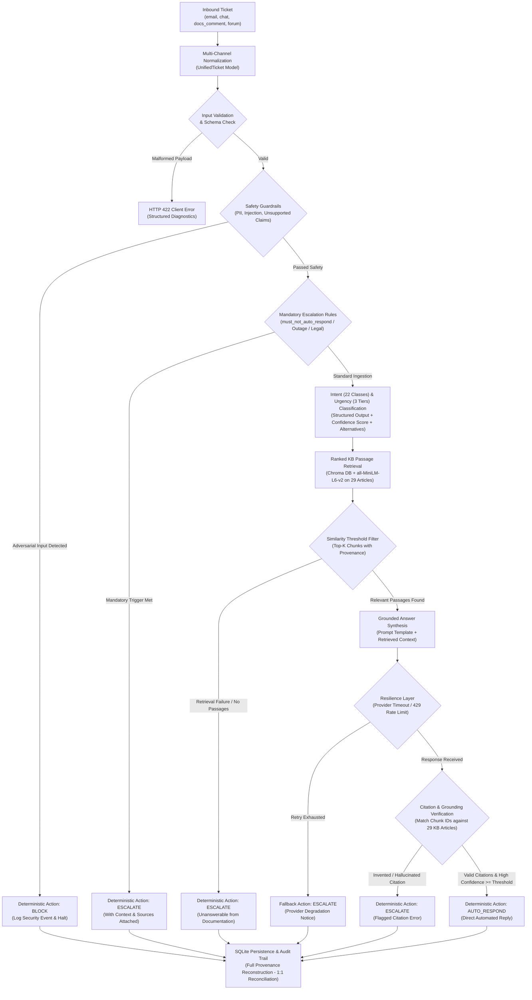

# CloudServe AI Support System - Architecture Design

## 1. System Overview

The CloudServe AI Support System is an enterprise support automation platform designed with a hybrid architecture: deterministic software governs routing, safety guardrails, citation verification, and error recovery, while agentic LLM components perform intent/urgency classification and grounded answer synthesis.

---

## 2. End-to-End Decision Flow

---

## 3. Core Architectural Subsystems & Acceptance Criteria Mapping

### 3.1 Multi-Channel Ingestion & Normalization (`src/cloudserve/ingestion/`) — A2
* Normalizes unstructured payloads from 4 channels (`email`, `chat`, `docs_comment`, `forum`) into a strongly typed `UnifiedTicket`.
* Validates inputs using Pydantic models; handles missing fields, unusual encodings, and empty bodies gracefully (A11).

### 3.2 Classification Engine (`src/cloudserve/classification/`) — A3
* Classifies tickets across all **22 dataset intent categories** without reduction or collapsing into broader buckets.
* Assigns urgency levels (`low`, `medium`, `high`) and computes calibrated numeric confidence scores `[0.0, 1.0]`.
* Provides defined fallbacks on classification uncertainty and tracks candidate alternatives.

### 3.3 Knowledge Base RAG & Ranking (`src/cloudserve/rag/`) — A4
* Indexes all 29 knowledge-base articles (`data/kb/documentation.json`) using Chroma vector database and `sentence-transformers/all-MiniLM-L6-v2`.
* Spans exactly 10 functional categories:
  - `account` (2 articles)
  - `api` (3 articles)
  - `authentication` (4 articles)
  - `billing` (3 articles)
  - `data` (3 articles)
  - `deployment` (4 articles)
  - `integration` (2 articles)
  - `onboarding` (2 articles)
  - `performance` (3 articles)
  - `security` (3 articles)
* Chunks preserve explicit provenance (`doc_id`, `title`, `category`, `chunk_id`).
* Returns ranked passages filtered by a similarity threshold; returns empty results rather than irrelevant passages.

### 3.4 Deterministic Routing Engine (`src/cloudserve/routing/`) — A5, PRD v2.0
* Implements authoritative PRD v2.0 policy (FR-04 to FR-07, FR-12, FR-13) with deterministic, idempotent software governance.
* **Three Approved Routing Outcomes**:
  - `AUTO_RESPOND`: Permitted only for low-risk, verified tickets where confidence meets threshold, relevant approved KB evidence exists, citations validate, guardrails pass, and the kill switch is enabled.
  - `DRAFT_FOR_REVIEW`: Unsent proposed response with rationale, citations, and verification checklist prepared for human review (never auto-sent to customers). Used for account-specific billing inquiries, contextual uncertainty, and kill-switch holds.
  - `ESCALATE`: Structured handoff to appropriate human/specialist groups (Security Operations, Compliance & Legal, Billing Operations, Product Management, Tier 2 Engineering) with issue summary, risk reasons, available history, and explicit statements when history or documentation is unavailable.
* **Decision Precedence Hierarchy**:
  1. *Safety Guardrail Failure Gate* (FR-04, FR-05) $\to$ `ESCALATE` (block customer release).
  2. *Mandatory Policy Escalations* (FR-07) $\to$ `ESCALATE` regardless of confidence or KB availability (Security incidents, Compliance, all Data Residency requests, Feature/Roadmap requests, Unclear requests, Classifier Fallback).
  3. *High Urgency with No KB Evidence Gate* (FR-07) $\to$ `ESCALATE` (prompt investigation for high-urgency undocumented tickets).
  4. *Billing Risk Classification* (FR-13) $\to$ Disputes/reversals (`ESCALATE`), Account-specific invoices (`DRAFT_FOR_REVIEW`), Ambiguous billing (`DRAFT_FOR_REVIEW`), General informational (`AUTO_RESPOND` eligible).
  5. *Knowledge Base Evidence & Relevance Gate* (FR-05) $\to$ `DRAFT_FOR_REVIEW` / `ESCALATE` (never invent technical/billing facts).
  6. *Citation Verification Gate* (FR-05, A6) $\to$ `DRAFT_FOR_REVIEW` if citations missing or unretrieved.
  7. *Operational Kill Switch Gate* (FR-12) $\to$ `DRAFT_FOR_REVIEW` (holds auto-responses safely).
  8. *Configurable Confidence Threshold Gates* (FR-04, FR-05, FR-06) $\to$ `AUTO_RESPOND` ($\ge \text{threshold}$), `DRAFT_FOR_REVIEW` ($\ge \text{review}$), `ESCALATE` ($< \text{review}$).
* **Strict Runtime Isolation**: The router operates strictly on live ticket data, classification outputs, and retrieved passages. It has zero access to evaluation ground truth (`expected_route`, `must_not_auto_respond`).

### 3.5 Evidence-Grounded Generation & Citation Verifier (`src/cloudserve/generation/`, `src/cloudserve/rag/citation.py`) — A6
* Constrains generation strictly to retrieved passage context; states plainly when it does not know.
* Formats citations as `[doc_id: Section-Name]` matching real passages in `documentation.json`.
* Detects and blocks invented or hallucinated citations, automatically downgrading the ticket to `escalate`.

### 3.6 Active Safety Guardrails (`src/cloudserve/guardrails/`) — A7
* Scans incoming ticket text and generated responses for private data (PII), prompt injection, and unsupported claims.
* Actively blocks adversarial or unsafe responses, terminates generation, and logs security incidents.

### 3.7 Persistent Audit Logging (`src/cloudserve/storage/`) — A8
* Synchronous SQLAlchemy with SQLite (`decisions.db`).
* Persists full decision schema per Governance Framework:
  `decision_id`, `created_at`, `ticket_id`, `stage`, `input_summary`, `model`, `prediction`, `confidence`, `alternatives`, `sources_used`, `threshold_applied`, `action_taken`, `reason`, `guardrail_results`, `prompt_version`, `requirement_ids`.
* Enables 100% post-hoc decision reconstruction with 1:1 reconciliation against processed tickets.

### 3.8 Resilience & Fault Tolerance Layer (`src/cloudserve/api/`, `src/cloudserve/generation/`) — A11
* Handles LLM provider outages, network timeouts, and HTTP 429 rate limits via exponential backoff with jitter and graceful degradation to escalation.
* Handles retrieval failures and malformed inputs (HTTP 422) without crashing.

### 3.9 Unattended Evaluation Pipeline (`src/cloudserve/evaluation/`, `scripts/evaluate.py`) — A9, A10
* Standalone CLI runner supporting arbitrary `--input` and `--output` paths without human intervention.
* **Strict Data Isolation:** `ground_truth_responses.json` and validation datasets are strictly isolated from runtime code.
* **Baseline and Target Definitions:**

| Metric | Source A: Evaluation Framework Baseline *(Target Benchmark in `Evaluation_Framework.docx`)* | Source B: Development Dataset Historical Outcomes *(Calculated from `data/dev/development_tickets.json`)* | Target for CloudServe *(Success Threshold)* |
| :--- | :-: | :-: | :-: |
| **First Contact Resolution (FCR)** | **42.0%** | **43.8%** (219 / 500 records where `history.first_contact_resolution == true`) | **$\ge$ 60.0%** |
| **Escalation Rate** | **58.0%** | **56.2%** (281 / 500 records where `history.escalated == true`) | **$\le$ 30.0%** |
| **Response / Resolution Times** | 8 to 12 hours *(first-response time)* | Mean: **421.7 min**, Median: **214.0 min** *(resolution time via `history.resolution_time_minutes`)* | **Median First Reply < 5 min** |
| **Customer Satisfaction (CSAT)** | 3.2 / 5.0 | Mean: **2.97 / 5.0** (2.972 from `history.csat_rating`) | **$\ge$ 4.0 / 5.0** |
| **Repeat Contacts** | *"Not measured"* | **21.6%** (108 / 500 records where `history.repeat_contact == true`) | **Halved ($\le$ 10.8%)** |

> *Note on Metric Definitions:* `history.resolution_time_minutes` in the dataset measures total ticket **resolution time**, not first-response time. The 8–12 hour first-response figure is a stakeholder-reported baseline in the Evaluation Framework.

* Automatically generates Markdown and JSON reports featuring:
  - **Tier 1 (Business):** First Contact Resolution (target >=60%), Response Times (target median <5min), Escalation Rate (target <=30%).
  - **Tier 2 (Technical):** Per-class Precision/Recall across all 22 intents (target >=85%), Hallucination rate (<=5%), Citation accuracy (>=95%), Latency p95 (<3s).
  - **Tier 3 (Governance):** Zero private data occurrences, Calibration error within 5 points of observed accuracy, Subgroup variation (<5 percentage points across customer tiers, regions, and fluencies).

### 3.10 Testability & CI (`tests/`, `.github/workflows/ci.yml`) — A1, A12
* Runs entire suite via `pytest`.
* Enforces linting, typing, and test execution across Python 3.10, 3.11, and 3.12.
